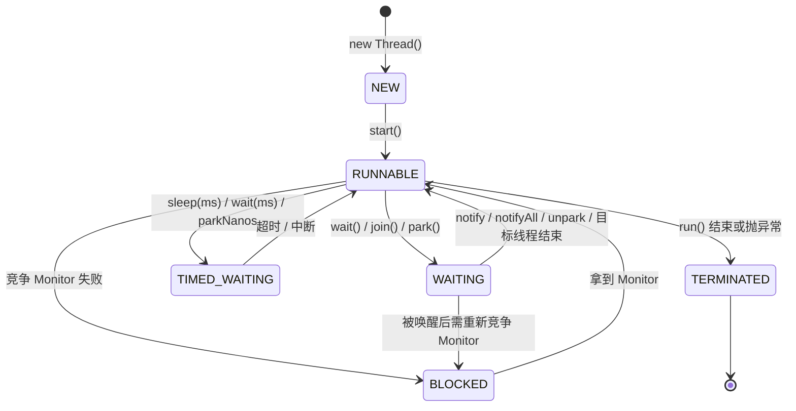
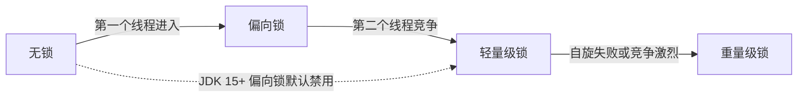
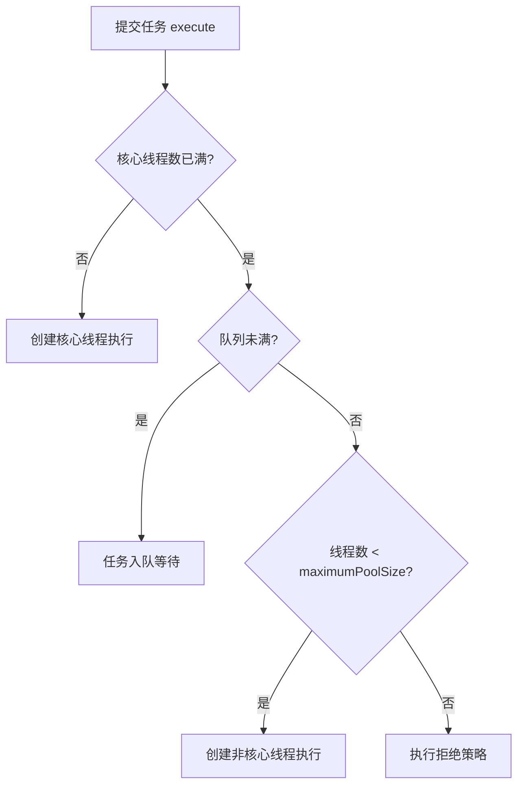

# Java 并发编程学习文档

Oct 13, 2026 · @meteorzhong

> 本文由原 PDF 转换整理，正文结构、表格与代码均保持一致，原文中的 3 张示意图改用 Mermaid 重绘。

## 导读

本文按《知识图谱.html》中「并发编程」分类的 6 个节点（JMM、线程与线程池、锁机制、CAS 与 AQS、JUC 并发容器、异步编排）加上「Java 核心」里的「虚拟线程」节点展开。每个知识点沿用图谱的三级标注：**【核心】** 必须能讲清原理并手写示例，**【重点】** 能说清用法与区别，**【了解】** 知道概念即可。

| 图谱节点 | 级别 | 本文章节 |
| --- | --- | --- |
| 线程与线程池（thread） | 核心 | 线程基础、线程池、ThreadLocal |
| JMM 与可见性（jmm） | 核心 | Java 内存模型 |
| 锁机制（lock） | 核心 | synchronized、Lock 体系、死锁 |
| CAS 与 AQS（cas-aqs） | 核心 | CAS、原子类与 AQS |
| JUC 并发容器（juc） | 核心 | 并发工具类、并发容器 |
| 异步编排（completable-future） | 重点 | 异步编程 |
| 虚拟线程（virtual-thread） | 重点 | 异步编程 · 虚拟线程 |

**建议学习顺序**（与图谱连线一致）：线程基础 → JMM → synchronized → CAS/AQS → Lock → 工具类与容器 → 线程池 → 异步编排与虚拟线程 → 问题排查。前四步是理论地基，后面都是在地基上的工具。

## 一、线程基础

线程是 CPU 调度的最小单位，Java 平台线程与操作系统线程 1:1 映射，创建与切换都有内核态开销，这是后面「线程池」和「虚拟线程」存在的根本原因。

### 1.1 创建线程的方式【重点】

本质上只有一种：`new Thread(...).start()`。常说的四种写法只是「任务」的提供方式不同：

1. 继承 `Thread` 并重写 `run()`：简单，但占用了单继承。
2. 实现 `Runnable`：任务与线程解耦，推荐。
3. 实现 `Callable<V>` + `FutureTask`：有返回值、可抛受检异常。
4. 线程池 `ExecutorService.submit()`：生产环境的标准做法。

```java
Callable<Integer> task = () -> 1 + 1;
FutureTask<Integer> ft = new FutureTask<>(task);
new Thread(ft, "worker-1").start();
Integer r = ft.get(); // 阻塞等待结果
```

**易错点**：直接调用 `run()` 只是普通方法调用，不会启动新线程；同一个 `Thread` 对象 `start()` 两次会抛 `IllegalThreadStateException`。

### 1.2 线程六种状态与流转【核心】

`Thread.State` 枚举定义了 6 种状态：

| 状态 | 含义 | 如何进入 |
| --- | --- | --- |
| NEW | 已创建未启动 | `new Thread()` |
| RUNNABLE | 就绪或运行中（Java 不区分） | `start()`；阻塞 I/O 也算 RUNNABLE |
| BLOCKED | 等待进入 synchronized 块 | 竞争 Monitor 失败 |
| WAITING | 无期限等待 | `wait()`、`join()`、`LockSupport.park()` |
| TIMED_WAITING | 限时等待 | `sleep(ms)`、`wait(ms)`、`join(ms)`、`parkNanos` |
| TERMINATED | 已结束 | `run()` 返回或抛出异常 |

从 WAITING / TIMED_WAITING 被唤醒后，若原本在 synchronized 内调用 `wait`，还要重新竞争 Monitor，失败则先进入 BLOCKED。

**面试要点**：BLOCKED 只与 synchronized 有关；用 `ReentrantLock` 等锁时线程是 WAITING，因为 AQS 底层用的是 `LockSupport.park()`。



> 图 1：线程状态流转 · 6 种状态

### 1.3 sleep / wait / join / yield 区别【重点】

| 方法 | 所属 | 是否释放锁 | 使用前提 | 唤醒方式 |
| --- | --- | --- | --- | --- |
| `sleep(ms)` | `Thread` 静态方法 | 不释放 | 无 | 超时或中断 |
| `wait()` | `Object` | 释放 Monitor | 必须在 synchronized 内 | `notify`/`notifyAll`、超时、中断 |
| `join()` | `Thread` 实例方法 | 底层是 wait，释放的是目标线程对象的锁 | 无 | 目标线程结束 |
| `yield()` | `Thread` 静态方法 | 不释放 | 无 | 仅提示调度器让出 CPU，不保证 |

### 1.4 线程中断（interrupt）【重点】

Java 没有安全的强制停止线程的方式（`stop()` 已废弃，会导致锁内状态不一致），中断是一种协作式通知：

- `t.interrupt()`：设置中断标志；若线程正在 `sleep` / `wait` / `join`，会抛出 `InterruptedException` 并清除标志。
- `t.isInterrupted()`：只查询；`Thread.interrupted()`：查询并清除当前线程标志。

捕获 `InterruptedException` 后不要吞掉，应该向上抛或重新 `Thread.currentThread().interrupt()` 恢复标志。

```java
while (!Thread.currentThread().isInterrupted()) {
    try {
        doWork();
        Thread.sleep(100);
    } catch (InterruptedException e) {
        Thread.currentThread().interrupt(); // 恢复标志，让循环退出
    }
}
```

### 1.5 守护线程【了解】

`setDaemon(true)` 必须在 `start()` 前调用。当 JVM 中只剩守护线程时 JVM 退出，守护线程的 `finally` 不保证执行，所以不要用它做写文件、提交事务等收尾工作。GC 线程是典型的守护线程。

### 1.6 线程通信：生产者-消费者【核心】

经典写法是 `wait` / `notify`。两个要点：判断条件必须用 `while` 而不是 `if`（防止虚假唤醒）；多生产者多消费者时用 `notifyAll`，否则可能唤醒同类导致全部等待。

```java
class Buffer {
    private final Queue<Integer> q = new LinkedList<>();
    private final int cap = 10;

    public synchronized void put(int v) throws InterruptedException {
        while (q.size() == cap) wait();
        q.offer(v);
        notifyAll();
    }

    public synchronized int take() throws InterruptedException {
        while (q.isEmpty()) wait();
        int v = q.poll();
        notifyAll();
        return v;
    }
}
```

生产环境更推荐直接用 `BlockingQueue`（见第七章），或用 `ReentrantLock` + 两个 `Condition`（notFull / notEmpty）实现精准唤醒。

## 二、Java 内存模型（JMM）

JMM 是一套规范，定义了多线程读写共享变量时「一个线程的写何时对另一个线程可见」；它是判断并发程序是否正确的理论地基，图谱中锁机制和 CAS/AQS 都从它延伸出去。注意不要与 JVM 运行时内存区域（堆、栈、方法区）混淆。

### 2.1 三大问题：原子性、可见性、有序性【核心】

| 问题 | 根源 | 典型例子 | 解决手段 |
| --- | --- | --- | --- |
| 原子性 | 线程切换，一条语句对应多条指令 | `i++` = 读、加、写三步 | synchronized、Lock、原子类 |
| 可见性 | CPU 缓存、写缓冲区，写未刷回主存 | 循环读一个普通 boolean 标志，永远看不到修改 | volatile、synchronized、final、Lock |
| 有序性 | 编译器与 CPU 指令重排序 | DCL 单例拿到半初始化对象 | volatile、synchronized |

**主内存与工作内存【重点】**：JMM 抽象地认为共享变量存在主内存，每个线程有自己的工作内存（对应寄存器、CPU 缓存），线程只能操作工作内存中的副本。

**as-if-serial【重点】**：不管怎么重排序，单线程的执行结果不能变，所以有数据依赖的指令不会被重排。它只管单线程，多线程间的顺序由 happens-before 管。

### 2.2 happens-before 规则【核心】

如果 A happens-before B，则 A 的结果对 B 可见，且 A 的顺序排在 B 之前。常用的 6 条：

1. **程序顺序规则**：同一线程中，前面的操作 hb 后面的操作。
2. **管程锁规则**：对一个锁的解锁 hb 后续对同一锁的加锁。
3. **volatile 规则**：对 volatile 变量的写 hb 后续对它的读。
4. **线程启动规则**：`t.start()` hb 线程 t 内的任何操作。
5. **线程终止规则**：线程 t 内的操作 hb 其他线程从 `t.join()` 返回。
6. **传递性**：A hb B，B hb C，则 A hb C。

另有中断规则（`interrupt()` hb 被中断线程检测到中断）和对象终结规则（构造完成 hb `finalize()`）。传递性 + volatile 规则组合起来，可以用一个 volatile 标志「发布」一批普通变量的写。

### 2.3 volatile【核心】

两个语义：保证可见性（写立即刷回主存，其他线程缓存行失效）；禁止指令重排序。不保证原子性。

实现原理：JIT 在 volatile 写前后插入内存屏障，x86 上表现为一条 `lock` 前缀指令，触发缓存一致性协议（MESI）。

| 屏障 | 作用 | volatile 中的位置 |
| --- | --- | --- |
| StoreStore | 前面的普通写先于 volatile 写刷新 | volatile 写之前 |
| StoreLoad | volatile 写先于后面的读，开销最大 | volatile 写之后 |
| LoadLoad | volatile 读先于后面的读 | volatile 读之后 |
| LoadStore | volatile 读先于后面的写 | volatile 读之后 |

**`i++` 问题**：10 个线程各对 `volatile int count` 自增 1000 次，结果通常小于 10000。两个线程可能同时读到同一个值，各自加 1 后写回，丢失一次更新。解决：`AtomicInteger` 或加锁。

**适用场景**：状态标志位（如 `volatile boolean running`）、DCL 单例、一写多读的配置发布。

### 2.4 DCL 单例为什么需要 volatile【核心】

```java
public class Singleton {
    private static volatile Singleton instance;

    private Singleton() {}

    public static Singleton getInstance() {
        if (instance == null) {          // 第一次检查，避免每次加锁
            synchronized (Singleton.class) {
                if (instance == null) {   // 第二次检查，防止重复创建
                    instance = new Singleton();
                }
            }
        }
        return instance;
    }
}
```

`new Singleton()` 分三步：1 分配内存 2 初始化对象 3 引用指向内存。2、3 可能被重排为 1-3-2，线程 B 在第一次检查时看到非 null，直接返回一个未初始化完成的对象。volatile 禁止这种重排。

### 2.5 CPU 缓存一致性与伪共享【了解】

CPU 以缓存行（通常 64 字节）为单位同步。两个无关变量落在同一缓存行，不同核心各自修改时会反复使对方缓存行失效，这就是**伪共享**。解决方式是缓存行填充或 `@jdk.internal.vm.annotation.Contended`，`LongAdder` 的 Cell 就加了这个注解。

## 三、synchronized 原理与锁升级

synchronized 是 JVM 层面的内置锁，同时保证原子性、可见性和有序性，可重入、非公平、不可中断。JDK 6 之后经过大量优化，在低竞争下性能与 ReentrantLock 接近。

### 3.1 三种用法与锁对象【核心】

| 写法 | 锁住的对象 |
| --- | --- |
| 修饰实例方法 | 当前实例 `this` |
| 修饰静态方法 | 类对象 `Xxx.class` |
| `synchronized (obj) {}` | 括号中的对象 |

实例锁与类锁互不影响。不要用 String 常量、`Integer` 等包装类做锁对象，它们可能被缓存共享，导致意外的锁竞争。

### 3.2 底层实现：Monitor【重点】

- **同步代码块**：编译后生成 `monitorenter` / `monitorexit` 字节码，通常有两个 `monitorexit`，一个用于正常退出、一个用于异常退出，保证异常时也释放锁。
- **同步方法**：方法表中加 `ACC_SYNCHRONIZED` 标志，由 JVM 隐式加解锁。
- **ObjectMonitor**（HotSpot C++ 实现）的关键字段：`_owner` 持有线程、`_recursions` 重入次数、`_EntryList` 等锁的线程（BLOCKED）、`_WaitSet` 调用了 `wait` 的线程（WAITING）。这也是 `wait` / `notify` 必须在 synchronized 内调用的原因。

### 3.3 对象头 Mark Word【重点】

HotSpot 对象头由 Mark Word + 类型指针（+ 数组长度）组成。64 位 JVM 下 Mark Word 占 8 字节，其末尾的锁标志位决定其余位的含义：

| 锁状态 | 标志位 | Mark Word 主要存储 |
| --- | --- | --- |
| 无锁 | 01（偏向位 0） | hashCode、分代年龄 |
| 偏向锁 | 01（偏向位 1） | 偏向线程 ID、epoch、分代年龄 |
| 轻量级锁 | 00 | 指向线程栈中 Lock Record 的指针 |
| 重量级锁 | 10 | 指向 ObjectMonitor 的指针 |
| GC 标记 | 11 | 空 |

### 3.4 锁升级【核心】

锁只能升级不能降级（重量级锁在 GC 安全点可能被清理），目的是按竞争程度选择最便宜的同步方式：

1. **偏向锁**：只有一个线程反复进入时，把线程 ID CAS 写入 Mark Word，之后进入只需比较 ID，几乎零开销。有第二个线程来时需要在安全点撤销偏向。
2. **轻量级锁**：多线程交替进入、几乎不同时竞争。线程在栈帧中建 Lock Record，用 CAS 把 Mark Word 替换为指向它的指针；失败则自旋重试。
3. **重量级锁**：自旋一定次数仍失败或竞争线程多时，膨胀为 ObjectMonitor，未拿到锁的线程进入 EntryList 阻塞，涉及用户态到内核态切换。



> 图 2：synchronized 锁升级路径 · 4 种状态

虚线框的偏向锁在 JDK 15 后默认不再出现，实际路径是下方的虚线箭头。

**版本变化【了解】**：偏向锁撤销成本高且现代应用多为线程池共享对象，JDK 15（JEP 374）起默认禁用并标记废弃，后续版本已移除相关实现。所以在 JDK 17/21 上谈锁升级，应说「无锁 → 轻量级 → 重量级」。另外，对象计算过 identity hashCode 后无法再偏向。

### 3.5 锁优化【重点】

- **自旋与自适应自旋**：不立即阻塞而是忙等几轮，自适应自旋会根据上次在同一锁上的自旋结果调整次数。
- **锁消除**：JIT 通过逃逸分析发现锁对象不会逃出当前线程（如方法内的 `StringBuffer`），直接去掉锁。
- **锁粗化**：循环内反复对同一对象加解锁时，合并成一次大范围加锁。

### 3.6 synchronized 与 ReentrantLock 对比【核心】

| 维度 | synchronized | ReentrantLock |
| --- | --- | --- |
| 实现层面 | JVM 关键字，Monitor | JDK 类，AQS |
| 加解锁 | 自动，异常时也释放 | 手动 `lock()`，必须在 finally 中 `unlock()` |
| 公平性 | 仅非公平 | 可选公平 / 非公平 |
| 可中断 | 否 | `lockInterruptibly()` |
| 超时获取 | 否 | `tryLock(timeout)` |
| 条件队列 | 一个 WaitSet | 多个 Condition，可精准唤醒 |
| 虚拟线程 | JDK 21 下会钉住载体线程（JDK 24 起已改善） | 不钉住 |

**选型建议**：简单互斥优先 synchronized，代码简洁且不会忘记解锁；需要可中断、超时、公平或多条件时用 ReentrantLock。

## 四、CAS、原子类与 AQS

CAS 是无锁编程的硬件原语，AQS 用「volatile state + CAS + CLH 队列 + park/unpark」搭起了 JUC 几乎所有同步器：ReentrantLock、ReentrantReadWriteLock、Semaphore、CountDownLatch、ThreadPoolExecutor.Worker 都是它的子类或内部类。

### 4.1 CAS 原理与 Unsafe【核心】

CAS（Compare-And-Swap）有三个操作数：内存地址 V、预期值 A、新值 B。仅当 V 的值等于 A 时才把它更新为 B，整个过程由一条 CPU 指令保证原子性（x86 上是 `lock cmpxchg`）。Java 中通过 `Unsafe.compareAndSwapXxx`（JDK 9 起推荐用 `VarHandle`）暴露。

```java
// AtomicInteger.getAndIncrement 的本质：自旋 + CAS
public final int getAndAddInt(Object o, long offset, int delta) {
    int v;
    do {
        v = getIntVolatile(o, offset);
    } while (!weakCompareAndSetInt(o, offset, v, v + delta));
    return v;
}
```

### 4.2 CAS 的三大问题【核心】

| 问题 | 说明 | 解决 |
| --- | --- | --- |
| ABA | 值从 A 变 B 又变回 A，CAS 误以为没变；链表、栈等引用结构上会出错 | `AtomicStampedReference`（版本号）、`AtomicMarkableReference`（标记位） |
| 自旋开销 | 高竞争下长时间失败自旋，空耗 CPU | LongAdder 分散热点；或改用锁 |
| 只能保证单变量 | 多个变量无法一次 CAS | 封装成对象用 `AtomicReference`；或加锁 |

### 4.3 原子类体系【重点】

- **基本类型**：`AtomicInteger`、`AtomicLong`、`AtomicBoolean`
- **数组**：`AtomicIntegerArray`、`AtomicLongArray`、`AtomicReferenceArray`
- **引用**：`AtomicReference`、`AtomicStampedReference`、`AtomicMarkableReference`
- **字段更新器**：`AtomicIntegerFieldUpdater` 等，字段必须是 volatile，用于大量对象时节省内存
- **累加器（JDK 8）**：`LongAdder`、`DoubleAdder`、`LongAccumulator`

**AtomicLong vs LongAdder**：LongAdder 内部有 `base + Cell[]`，无竞争时只更新 base；有竞争时不同线程按哈希更新不同 Cell，`sum()` 时再汇总。高并发计数（QPS 统计、点赞数）用 LongAdder；需要精确实时值或 CAS 语义（如生成序列号）用 AtomicLong，因为 `sum()` 不是原子快照。

### 4.4 AQS 核心结构【核心】

- **`volatile int state`**：同步状态，含义由子类定义。ReentrantLock 中是重入次数；Semaphore 中是剩余许可；CountDownLatch 中是剩余计数；读写锁中高 16 位是读锁、低 16 位是写锁。
- **CLH 变体双向队列**：获取失败的线程封装成 Node 尾插入队，头节点是虚节点（当前持有者）。Node 有 `waitStatus`（SIGNAL、CANCELLED、CONDITION、PROPAGATE）。
- **`exclusiveOwnerThread`**：独占模式下的持有线程。
- **模板方法模式**：子类只需实现 `tryAcquire` / `tryRelease`（独占）或 `tryAcquireShared` / `tryReleaseShared`（共享），入队、阻塞、唤醒由 AQS 完成。

### 4.5 ReentrantLock 加解锁的 AQS 流程【核心】

**加锁（非公平）**：

1. `lock()` 先直接 CAS 把 state 从 0 改为 1，成功则设置 owner 为当前线程（插队）。
2. 失败进入 `acquire(1)` → `tryAcquire`：state 为 0 再 CAS 一次；如果 owner 是自己则 state+1（重入）。
3. 仍失败则 `addWaiter` 将当前线程封装为 Node CAS 尾插入队。
4. `acquireQueued` 自旋：前驱是 head 则再试 `tryAcquire`；否则把前驱 `waitStatus` 设为 SIGNAL 后 `LockSupport.park()` 挂起。

**解锁**：`release(1)` → `tryRelease` 使 state-1，减到 0 时清空 owner，并 `unparkSuccessor` 唤醒 head 的后继（若后继已取消则从队尾往前找）。

**公平与非公平的唯一区别**：公平锁 `tryAcquire` 中多了 `hasQueuedPredecessors()` 判断，队列里有人就不插队。非公平吞吐更高（减少线程唤醒切换），但可能导致队列中的线程饥饿。

### 4.6 独占模式与共享模式【重点】

独占模式一次只唤醒一个后继。共享模式下线程获取成功后，如果还有剩余资源（`tryAcquireShared` 返回值 > 0），会通过 `setHeadAndPropagate` 继续唤醒后继，形成「传播」。CountDownLatch 归零时一次性放行所有等待线程就是靠这个机制。

### 4.7 Condition 条件队列【了解】

每个 `ConditionObject` 维护一个单向条件队列。`await()` 释放锁并把线程加入条件队列挂起；`signal()` 把条件队列头节点转移到 AQS 同步队列尾部，等它重新竞争到锁后才从 `await()` 返回。

## 五、Lock 体系

`java.util.concurrent.locks` 包提供了比 synchronized 更灵活的显式锁，核心是 ReentrantLock；读多写少场景用读写锁或 StampedLock。

### 5.1 ReentrantLock 标准用法【核心】

```java
private final ReentrantLock lock = new ReentrantLock(); // true 为公平锁

public void transfer() {
    lock.lock();   // 放在 try 外：加锁失败时不应执行 unlock
    try {
        // 临界区
    } finally {
        lock.unlock(); // 必须在 finally 中释放
    }
}

// 避免死等：限时获取
if (lock.tryLock(1, TimeUnit.SECONDS)) {
    try { /* ... */ } finally { lock.unlock(); }
} else {
    // 降级或重试
}
```

重入几次就要释放几次，否则其他线程永远拿不到锁。

### 5.2 Condition 精准唤醒【重点】

一把锁可以创建多个 Condition，对应 Object 的 `wait` / `notify`：`await()` ↔ `wait()`，`signal()` ↔ `notify()`，`signalAll()` ↔ `notifyAll()`。经典题「三个线程轮流打印 ABC」就是用三个 Condition 实现。

```java
class BoundedBuffer<T> {
    private final ReentrantLock lock = new ReentrantLock();
    private final Condition notFull = lock.newCondition();
    private final Condition notEmpty = lock.newCondition();
    private final Object[] items = new Object[16];
    private int putIdx, takeIdx, count;

    public void put(T x) throws InterruptedException {
        lock.lock();
        try {
            while (count == items.length) notFull.await();
            items[putIdx] = x;
            putIdx = (putIdx + 1) % items.length;
            count++;
            notEmpty.signal(); // 只唤醒消费者
        } finally {
            lock.unlock();
        }
    }

    @SuppressWarnings("unchecked")
    public T take() throws InterruptedException {
        lock.lock();
        try {
            while (count == 0) notEmpty.await();
            T x = (T) items[takeIdx];
            takeIdx = (takeIdx + 1) % items.length;
            count--;
            notFull.signal(); // 只唤醒生产者
            return x;
        } finally {
            lock.unlock();
        }
    }
}
```

这正是 ArrayBlockingQueue 的实现思路。

### 5.3 ReentrantReadWriteLock【重点】

- 规则：读读共享，读写、写写互斥。
- 实现：一个 AQS，state 高 16 位记读锁持有数、低 16 位记写锁重入数。
- **锁降级**：持有写锁 → 获取读锁 → 释放写锁，允许，用于保证「刚写完的数据自己接着读到的是最新值」。
- **不支持锁升级**：持有读锁再去拿写锁会死锁（写锁要等所有读锁释放，包括自己的）。
- 缺点：读多写少时写线程可能饥饿。

### 5.4 StampedLock【重点】

JDK 8 引入，三种模式：写锁、悲观读锁、乐观读。乐观读不加锁，只拿一个戳记（stamp），读完后校验期间有没有写入，有则升级为悲观读。

```java
long stamp = sl.tryOptimisticRead();
double cx = x, cy = y;          // 读到局部变量
if (!sl.validate(stamp)) {      // 期间有写入，退化为悲观读
    stamp = sl.readLock();
    try {
        cx = x; cy = y;
    } finally {
        sl.unlockRead(stamp);
    }
}
```

注意：StampedLock 不可重入、不支持 Condition；在 `readLock()` / `writeLock()` 上阻塞的线程被中断时可能导致 CPU 飙升，需要可中断时用 `readLockInterruptibly()`。

### 5.5 三种读写方案怎么选

| 场景 | 推荐 |
| --- | --- |
| 读写比例差不多，逻辑简单 | synchronized / ReentrantLock |
| 读多写少，需要重入或 Condition | ReentrantReadWriteLock |
| 读极多、读操作短小且追求极致性能 | StampedLock 乐观读 |
| 极少写、可容忍短暂不一致 | CopyOnWrite 容器 / volatile 引用整体替换 |

## 六、并发工具类

JUC 的工具类解决的是「多个线程之间怎么协调节奏」，面试最常考的是前三者的区别。

### 6.1 三大工具对比【核心】

| 工具 | 作用 | 能否重用 | 底层 | 典型场景 |
| --- | --- | --- | --- | --- |
| CountDownLatch | 一个或多个线程等待其他 N 个任务完成 | 否，计数归零后失效 | AQS 共享模式 | 主线程等并行子任务全部返回后汇总 |
| CyclicBarrier | N 个线程互相等待，全部到达屏障后一起继续 | 是，自动重置 | ReentrantLock + Condition | 分阶段并行计算、多线程压测同时发起 |
| Semaphore | 控制同时访问某资源的线程数 | 是 | AQS 共享模式 | 限流、连接池、虚拟线程下控制并发度 |

一句话区分：CountDownLatch 是「一个等多个」，谁都可以 `countDown`；CyclicBarrier 是「多个互相等」，参与者自己 `await`。

```java
// CountDownLatch：并行调用 3 个接口后汇总
CountDownLatch latch = new CountDownLatch(3);
for (Runnable call : calls) {
    pool.execute(() -> {
        try { call.run(); } finally { latch.countDown(); } // finally 保证必定计数
    });
}
if (!latch.await(2, TimeUnit.SECONDS)) { /* 超时处理 */ }

// Semaphore：最多 10 个并发访问下游
Semaphore sem = new Semaphore(10);
sem.acquire();
try { callDownstream(); } finally { sem.release(); }
```

**常见坑**：`countDown` 不放 finally 导致异常时主线程永久等待；CyclicBarrier 中一个线程被中断或超时，屏障进入 broken 状态，其他线程收到 `BrokenBarrierException`。

### 6.2 Exchanger 与 Phaser【了解】

- **Exchanger**：两个线程在同步点交换数据，例如双缓冲区、数据校对。
- **Phaser**（JDK 7）：可动态注册/注销参与者的多阶段屏障，功能上覆盖 CountDownLatch 和 CyclicBarrier，适合阶段数与参与者都不固定的任务。

### 6.3 LockSupport【重点】

`park()` / `unpark(thread)` 是 JUC 阻塞唤醒的底层原语。与 `wait` / `notify` 相比：不需要先获取锁；可以指定唤醒哪个线程；基于一个最多为 1 的「许可」，先 `unpark` 再 `park` 不会阻塞（不存在 `notify` 先于 `wait` 导致的丢失唤醒）。线程被中断时 `park` 会直接返回但不抛异常。

## 七、并发容器

并发容器用更细的锁粒度或无锁算法替代 `Collections.synchronizedXxx` 和 `Hashtable` 的「整表一把锁」。

### 7.1 ConcurrentHashMap【核心】

**JDK 7 vs JDK 8**：

| 维度 | JDK 7 | JDK 8 |
| --- | --- | --- |
| 结构 | Segment 数组 + HashEntry 数组 + 链表 | Node 数组 + 链表 + 红黑树 |
| 锁 | 分段锁，Segment 继承 ReentrantLock，默认 16 段 | CAS + synchronized 锁桶的头节点 |
| 并发度 | 等于 Segment 数，创建后不变 | 等于桶数，粒度更细 |
| 查询复杂度 | 链表 O(n) | 树化后 O(log n) |
| size | 先不加锁统计两次，不一致再全部加锁 | `baseCount + CounterCell[]`，思路同 LongAdder |

**JDK 8 put 流程**：

1. key 和 value 都不允许为 null（避免 `get` 返回 null 时无法区分「不存在」和「值为 null」的二义性）。
2. 计算 hash（`spread`：高 16 位异或低 16 位，并保证为正数）。
3. 表未初始化则 `initTable`（CAS 修改 `sizeCtl` 抢初始化权）。
4. 目标桶为空 → CAS 放入新节点，不加锁。
5. 桶头 hash 为 MOVED（-1）→ 正在扩容，当前线程 `helpTransfer` 协助扩容。
6. 否则 synchronized 锁住桶头节点，插入链表或红黑树；链表长度 ≥ 8 且数组长度 ≥ 64 时树化。
7. `addCount` 更新计数，超过阈值触发扩容。

**扩容**：容量翻倍，按 stride（最小 16 个桶）分配迁移任务，多线程并行迁移；迁移完的桶放一个 ForwardingNode，读到它的 `get` 会去新表查找。`get` 全程不加锁，依赖 Node 的 val 和 next 是 volatile。

**复合操作仍不安全**：`if (!map.containsKey(k)) map.put(k, v)` 不是原子的，应改用 `putIfAbsent`、`computeIfAbsent`、`merge`。计数的推荐写法：`map.merge(word, 1L, Long::sum)`。

### 7.2 CopyOnWriteArrayList【重点】

写操作加锁后复制一份新数组，在新数组上修改，再把 volatile 引用指向新数组；读操作不加锁。迭代器是快照（fail-safe），不会抛 `ConcurrentModificationException`。

**适用**：读远多于写、数据量小，如监听器列表、白名单、路由表。

**缺点**：写时内存占用翻倍，可能引发 GC；只保证最终一致，读不到正在进行的写。

### 7.3 BlockingQueue【核心】

阻塞队列是生产者-消费者模型和线程池的基础。四组 API：

| 行为 | 抛异常 | 返回特殊值 | 阻塞 | 超时 |
| --- | --- | --- | --- | --- |
| 插入 | `add` | `offer` | `put` | `offer(e, t, unit)` |
| 移除 | `remove` | `poll` | `take` | `poll(t, unit)` |
| 查看 | `element` | `peek` | — | — |

| 实现 | 结构与边界 | 锁 | 场景 |
| --- | --- | --- | --- |
| ArrayBlockingQueue | 数组，有界，必须指定容量 | 一把 ReentrantLock + 2 个 Condition | 容量固定、内存可控 |
| LinkedBlockingQueue | 链表，默认 `Integer.MAX_VALUE`（近乎无界） | putLock / takeLock 两把锁，吞吐更高 | 通用，务必指定容量 |
| SynchronousQueue | 不存储元素，一个 put 必须等一个 take | CAS | 直接移交，`newCachedThreadPool` |
| PriorityBlockingQueue | 堆，无界 | 一把锁 | 按优先级处理任务 |
| DelayQueue | 优先队列，元素实现 `Delayed`，无界 | 一把锁 | 延时任务、订单超时取消、缓存过期 |
| LinkedTransferQueue | 链表，无界 | CAS | 生产者可等待消费者接收 |

### 7.4 其他非阻塞容器【了解】

- `ConcurrentLinkedQueue`：基于 CAS 的无锁无界队列（Michael-Scott 算法），`size()` 需要遍历。
- `ConcurrentSkipListMap` / `Set`：基于跳表的有序并发 Map，平均 O(log n)，需要排序的并发场景替代 TreeMap。

## 八、线程池

线程池通过复用线程降低创建销毁开销，并用队列和拒绝策略把并发量卡在可控范围内，是图谱中「线程与线程池」节点标注核心最多的部分。

### 8.1 ThreadPoolExecutor 七大参数【核心】

| 参数 | 含义 | 配置要点 |
| --- | --- | --- |
| `corePoolSize` | 核心线程数，默认不会被回收 | `allowCoreThreadTimeOut(true)` 可使其超时回收 |
| `maximumPoolSize` | 最大线程数 | 队列满后才会开到这个数 |
| `keepAliveTime` | 非核心线程的空闲存活时间 | 短任务、流量波动大时可调长 |
| `unit` | `keepAliveTime` 的单位 | — |
| `workQueue` | 任务队列 | 务必用有界队列 |
| `threadFactory` | 线程工厂 | 设置有意义的线程名，便于 jstack 排查 |
| `handler` | 拒绝策略 | 队列满且线程到最大值时触发 |

### 8.2 任务提交与执行流程【核心】

`execute(task)` 的判断顺序是核心线程 → 队列 → 非核心线程 → 拒绝：

1. 工作线程数 < `corePoolSize`：新建核心线程执行，即使有空闲线程。
2. 否则尝试放入 `workQueue`。
3. 队列已满且线程数 < `maximumPoolSize`：新建非核心线程执行该任务。
4. 否则执行拒绝策略。



> 图 3：ThreadPoolExecutor.execute 判断流程 · 3 个判断

队列容量设得越大，非核心线程越难被创建；用无界队列时 `maximumPoolSize` 实际上失效。

**线程复用原理**：每个线程被封装为 Worker（继承 AQS 实现不可重入锁），`runWorker` 在循环中 `getTask()` 从队列取任务；非核心线程用 `poll(keepAliveTime)` 取不到任务就退出，核心线程用 `take()` 永久阻塞。线程池状态与线程数压在一个 `AtomicInteger ctl` 中：高 3 位是状态（RUNNING、SHUTDOWN、STOP、TIDYING、TERMINATED），低 29 位是线程数。

**Tomcat 的不同**：Tomcat 线程池会先把线程开到 max 再入队，更适合 I/O 密集的 Web 请求。

### 8.3 四种拒绝策略【核心】

| 策略 | 行为 | 适用 |
| --- | --- | --- |
| AbortPolicy（默认） | 抛 `RejectedExecutionException` | 关键业务，让调用方感知失败 |
| CallerRunsPolicy | 由提交任务的线程自己执行 | 不允许丢任务，同时对提交方形成自然背压 |
| DiscardPolicy | 静默丢弃 | 可丢弃的任务，如上报统计 |
| DiscardOldestPolicy | 丢弃队列最旧的任务，再重试提交 | 新任务比旧任务重要 |

**自定义**：实现 `RejectedExecutionHandler`，常见做法是记录日志 + 告警 + 持久化到 MQ / 数据库稍后重试。

### 8.4 Executors 工厂方法的隐患【核心】

《阿里巴巴 Java 开发手册》禁止使用 Executors 创建线程池：

| 方法 | 配置 | 风险 |
| --- | --- | --- |
| `newFixedThreadPool` / `newSingleThreadExecutor` | LinkedBlockingQueue 无参构造，容量 `Integer.MAX_VALUE` | 任务堆积 OOM |
| `newCachedThreadPool` | max = `Integer.MAX_VALUE` + SynchronousQueue | 线程数暴涨 OOM、CPU 打满 |
| `newScheduledThreadPool` | max = `Integer.MAX_VALUE` + DelayedWorkQueue（无界） | 任务堆积 OOM |

### 8.5 线程池大小估算【核心】

- **CPU 密集型**：线程数 ≈ N(CPU) + 1，多出的 1 个用于弥补缺页等偶发停顿。
- **I/O 密集型**：线程数 ≈ N(CPU) × (1 + 平均等待时间 / 平均计算时间)，经验值常取 2N。

$$N_{threads} = N_{cpu} \times U_{cpu} \times \left(1 + \frac{W}{C}\right)$$

公式只是起点。生产上应先按公式估算，再通过压测观察 CPU 使用率、RT、队列堆积来调整，并支持动态调参。

### 8.6 execute 与 submit、异常处理【重点】

- `execute(Runnable)` 无返回值，任务抛出的异常会打印堆栈并导致该工作线程退出（线程池再补一个新线程）。
- `submit()` 返回 Future，异常被封装在 Future 里，不调用 `get()` 就看不到异常，这是线上「任务悄悄失败」的常见原因。
- **兜底方式**：任务内 try-catch；ThreadFactory 中设置 `UncaughtExceptionHandler`（只对 execute 生效）；重写 `afterExecute(Runnable, Throwable)`。

### 8.7 优雅关闭【重点】

`shutdown()` 不再接新任务，等队列中任务执行完；`shutdownNow()` 尝试中断所有工作线程，并返回未执行的任务列表。标准写法：

```java
pool.shutdown();
try {
    if (!pool.awaitTermination(30, TimeUnit.SECONDS)) {
        List<Runnable> dropped = pool.shutdownNow();
        log.warn("强制关闭，丢弃 {} 个任务", dropped.size());
    }
} catch (InterruptedException e) {
    pool.shutdownNow();
    Thread.currentThread().interrupt();
}
```

### 8.8 生产实践：隔离、监控与动态调参【重点】

- **隔离**：不同业务用不同线程池，避免慢接口拖垮整个应用；父子任务不要共用一个池，否则父任务占满线程等子任务会造成死锁。
- **监控**：定时采集 `getActiveCount()`、`getQueue().size()`、`getCompletedTaskCount()`、`getLargestPoolSize()`，队列使用率超阈值告警。
- **动态调参**：`setCorePoolSize()`、`setMaximumPoolSize()` 可运行时修改；队列容量是 final，需要自定义可变容量队列。美团的动态线程池方案、开源的 Hippo4j、DynamicTp 都是这个思路。

### 8.9 ScheduledThreadPoolExecutor【了解】

用 `DelayedWorkQueue`（堆）按触发时间排序。`scheduleAtFixedRate` 按固定频率，上次未执行完则顺延；`scheduleWithFixedDelay` 以上次结束时间为起点。任务抛异常会导致后续调度停止，必须在任务内 catch。相比之下 Timer 是单线程，一个任务异常会杀死所有定时任务，不建议使用。

## 九、异步编程与虚拟线程

串行调用 3 个各耗时 100 ms 的下游接口需要约 300 ms，并行编排后只需约 100 ms，这是 CompletableFuture 在接口优化中最常见的用法；虚拟线程则让同步写法也能撑起高并发。

### 9.1 Future 的局限【重点】

`Future.get()` 会阻塞；只能轮询 `isDone()`；无法链式组合多个异步结果；异常处理不便。`CompletableFuture`（JDK 8）实现了 `Future + CompletionStage`，支持回调与组合。

### 9.2 CompletableFuture 常用 API【重点】

不带 Async 后缀的回调可能在上一个任务的线程或调用线程中执行；带 Async 后缀的会提交到线程池。

| 类别 | 方法 | 说明 |
| --- | --- | --- |
| 创建 | `supplyAsync(supplier, executor)` / `runAsync` | 有 / 无返回值 |
| 转换 | `thenApply(fn)` | 同步转换结果，类似 `Stream.map` |
| 消费 | `thenAccept` / `thenRun` | 消费结果 / 不关心结果 |
| 串联 | `thenCompose(fn)` | fn 返回另一个 CF，扁平化，类似 flatMap |
| 合并两个 | `thenCombine(other, bifn)` | 两个都完成后合并结果 |
| 全部 / 任一 | `allOf(...)` / `anyOf(...)` | `allOf` 返回 `CompletableFuture<Void>` |
| 异常 | `exceptionally` / `handle` / `whenComplete` | 仅异常时兜底 / 结果和异常都拿到并可改结果 / 只观察不改结果 |
| 超时（JDK 9） | `orTimeout` / `completeOnTimeout` | 超时抛异常 / 超时用默认值 |

```java
ExecutorService ioPool = new ThreadPoolExecutor(16, 32, 60, TimeUnit.SECONDS,
        new LinkedBlockingQueue<>(1000),
        r -> new Thread(r, "order-detail-" + r.hashCode()),
        new ThreadPoolExecutor.CallerRunsPolicy());

CompletableFuture<User> userF = CompletableFuture
        .supplyAsync(() -> userService.get(uid), ioPool);

CompletableFuture<List<Order>> orderF = CompletableFuture
        .supplyAsync(() -> orderService.list(uid), ioPool)
        .completeOnTimeout(List.of(), 200, TimeUnit.MILLISECONDS); // 超时降级

CompletableFuture<Coupon> couponF = CompletableFuture
        .supplyAsync(() -> couponService.get(uid), ioPool)
        .exceptionally(ex -> Coupon.EMPTY); // 异常降级

CompletableFuture.allOf(userF, orderF, couponF).join();
DetailVO vo = new DetailVO(userF.join(), orderF.join(), couponF.join());
```

### 9.3 必须使用自定义线程池【核心】

不传 executor 时默认使用 `ForkJoinPool.commonPool()`，其并行度为 CPU 核数 - 1。它被整个 JVM 共享（parallelStream 也用它），一旦放入阻塞 I/O 任务就会把公共池占满，其他业务全部排队。所以生产上按业务传入独立的有界线程池。

### 9.4 ForkJoinPool 与工作窃取【了解】

ForkJoin 是分治框架：大任务 `fork()` 拆成小任务，`join()` 合并结果，任务继承 `RecursiveTask<V>`（有返回值）或 `RecursiveAction`。每个工作线程有自己的双端队列，从队头取自己的任务；空闲时从其他线程队列的**队尾「窃取」**任务，减少竞争并提高 CPU 利用率。适合 CPU 密集的递归计算，不适合阻塞 I/O。

### 9.5 虚拟线程（JDK 21）【重点】

**调度差异【核心】**：平台线程由操作系统调度，每个占 1 MB 左右栈空间；虚拟线程由 JVM 调度，挂载到少量「载体线程」（carrier，默认来自一个并行度等于核数的 ForkJoinPool）上运行，栈以堆对象形式保存，可以轻松创建百万级。遇到阻塞 I/O、`sleep`、`LockSupport.park` 时，虚拟线程从载体上卸载（Continuation 保存栈帧），载体去跑别的虚拟线程。

```java
try (var executor = Executors.newVirtualThreadPerTaskExecutor()) {
    for (int i = 0; i < 10_000; i++) {
        executor.submit(() -> callRemote()); // 每个任务一个虚拟线程
    }
}

Thread.ofVirtual().name("vt-", 0).start(task);
```

**使用原则**：

1. **适合 I/O 密集，而非 CPU 密集【核心】**：虚拟线程不会让计算变快，只提升等待场景的吞吐。
2. **不要池化虚拟线程【重点】**：它很便宜，用完即弃；要限制对下游的并发度，用 Semaphore，不要用线程池大小限流。
3. **小心 pinning（钉住）【重点】**：JDK 21 中在 synchronized 块内阻塞、或在本地方法中阻塞时，虚拟线程无法卸载，会把载体线程一起卡住。可用 `-Djdk.tracePinnedThreads=full` 排查，老代码中热点锁改用 ReentrantLock。JDK 24（JEP 491）已解决 synchronized 引起的钉住。
4. **ThreadLocal 内存风险【重点】**：百万虚拟线程各持有一份 ThreadLocal 副本，内存会膨胀；且虚拟线程不复用，用 ThreadLocal 做缓存没有意义。

### 9.6 结构化并发与 ScopedValue【了解】

- **结构化并发**（`StructuredTaskScope`，预览特性）：把一组子任务当成一个工作单元，一个失败自动取消其余，父任务结束时保证子任务都已结束，避免线程泄漏。
- **ScopedValue**（JDK 25 转正）：不可变、有明确作用域的上下文传递，是虚拟线程时代 ThreadLocal 的替代品。

## 十、ThreadLocal 与常见并发问题

ThreadLocal 用「每个线程一份副本」绕开共享，是另一种线程安全思路；本章后半部分整理死锁等问题的排查方法。

### 10.1 ThreadLocal 原理【核心】

数据并不存在 ThreadLocal 里，而是存在每个 Thread 对象的 `threadLocals` 字段（一个 ThreadLocalMap）中。Map 的 key 是 ThreadLocal 对象本身（弱引用），value 是副本（强引用）。ThreadLocalMap 用数组 + **开放寻址法（线性探测）**解决哈希冲突，而不是 HashMap 的链表。

典型场景：用户登录上下文、链路 TraceId、数据库连接与事务（Spring `TransactionSynchronizationManager`）、线程不安全的 SimpleDateFormat。

### 10.2 内存泄漏【核心】

引用链：`Thread → ThreadLocalMap → Entry → value`。ThreadLocal 外部强引用被置空后，key 作为弱引用在 GC 时被回收变为 null，但 value 仍被强引用。线程池中线程长期存活，这些 value 就永远无法回收。

**为什么 key 用弱引用**：如果是强引用，ThreadLocal 对象本身也会泄漏；弱引用至少让 key 可回收，并且 `get` / `set` / `remove` 时会顺带清理 key 为 null 的「过期 Entry」。但这种清理是被动的，不可依赖。

**规范写法**：用 `static final` 修饰 ThreadLocal，并在 finally 中 `remove()`。线程池场景不 remove 还会导致脏数据：下一个请求复用线程时读到上一个用户的信息。

```java
private static final ThreadLocal<UserContext> CTX = new ThreadLocal<>();

public void handle(Request req) {
    CTX.set(parse(req));
    try {
        service.process();
    } finally {
        CTX.remove();
    }
}
```

### 10.3 InheritableThreadLocal 与 TransmittableThreadLocal【重点】

- **InheritableThreadLocal**：子线程创建时（Thread 构造器中）复制父线程的值。线程池中线程是复用的，只在第一次创建时复制，之后拿到的是旧值。
- **TransmittableThreadLocal**（阿里开源 TTL）：在任务提交时捕获上下文、执行前回放、执行后恢复，用 `TtlExecutors.getTtlExecutorService(pool)` 包装线程池，解决线程池场景下 TraceId 等上下文传递。

### 10.4 死锁【核心】

四个必要条件（同时满足才会死锁）：

| 条件 | 含义 | 破坏方式 |
| --- | --- | --- |
| 互斥 | 资源一次只能被一个线程占用 | 通常无法破坏（锁本身就是互斥） |
| 占有并等待 | 持有一个资源的同时等待另一个 | 一次性申请所有资源 |
| 不可剥夺 | 已占有的资源不能被强行抢走 | `tryLock(timeout)` 失败就主动释放已持有的锁 |
| 循环等待 | 线程间形成资源等待环 | 按固定顺序加锁，如按账户 ID 大小 |

```java
// 转账：按 id 顺序加锁，消除循环等待
void transfer(Account a, Account b, long amt) {
    Account first = a.id < b.id ? a : b;
    Account second = a.id < b.id ? b : a;
    synchronized (first) {
        synchronized (second) {
            a.debit(amt);
            b.credit(amt);
        }
    }
}
```

**排查步骤**：

1. `jps -l` 找到进程 ID。
2. `jstack <pid>`，输出末尾会直接报告 `Found one Java-level deadlock`，并列出每个线程 `waiting to lock` 和 `locked` 的对象地址。
3. 也可用 JConsole / VisualVM 的「检测死锁」、Arthas 的 `thread -b`，或代码中调用 `ThreadMXBean.findDeadlockedThreads()` 定时检测。

### 10.5 活锁与饥饿【了解】

- **活锁**：线程没有阻塞，但互相谦让、不断重试却都无法推进。解决：重试时加入随机退避时间。
- **饥饿**：线程长期拿不到资源，如非公平锁下的队列线程、读写锁下的写线程。解决：公平锁、控制持锁时间。

### 10.6 线上问题速查表

| 现象 | 可能原因 | 排查手段 |
| --- | --- | --- |
| CPU 100% | 死循环、CAS 空转、频繁 GC | `top -Hp <pid>` 找线程 → `printf '%x'` 转 16 进制 → jstack 中搜 nid |
| 接口全部卡住 | 死锁、线程池打满、下游无超时 | jstack 看 BLOCKED / WAITING 线程的等待对象 |
| 任务悄悄消失 | submit 后未调用 get、拒绝策略为 Discard | 加 afterExecute 日志、检查拒绝策略 |
| 内存持续上涨 | 无界队列堆积、ThreadLocal 未 remove | `jmap -histo`、dump 后用 MAT 分析 |
| 用户看到别人的数据 | ThreadLocal 未清理被复用 | 检查 finally 中的 remove |

## 十一、高频面试题与学习检查清单

下面 15 道题覆盖图谱中全部「核心」知识点，答案要点都能在前文对应章节找到展开。

### 11.1 高频面试题

| # | 题目 | 答案要点 | 章节 |
| --- | --- | --- | --- |
| 1 | 线程有哪几种状态？BLOCKED 和 WAITING 的区别？ | 6 种状态；BLOCKED 只因等 synchronized，WAITING 是主动 wait/park | 一 |
| 2 | sleep 和 wait 的区别？ | 所属类、是否释放锁、是否需在同步块内、唤醒方式 | 一 |
| 3 | volatile 能保证什么？为什么 i++ 不安全？ | 可见性 + 有序性，不保证原子性；i++ 是读-改-写三步 | 二 |
| 4 | DCL 单例为什么要加 volatile？ | new 对象三步可能重排，其他线程拿到半初始化对象 | 二 |
| 5 | 说说 happens-before 规则 | 程序顺序、锁、volatile、start、join、传递性 | 二 |
| 6 | synchronized 底层原理与锁升级 | monitorenter/exit、ObjectMonitor、Mark Word；偏向 → 轻量 → 重量，JDK 15 后偏向锁默认禁用 | 三 |
| 7 | synchronized 和 ReentrantLock 的区别 | 实现层、释放方式、公平、可中断、超时、多 Condition | 三 |
| 8 | CAS 有什么问题？ | ABA、自旋开销、只能单变量，各自解决方案 | 四 |
| 9 | 讲讲 AQS 原理，ReentrantLock 怎么加锁 | state + CLH 队列 + park；tryAcquire → addWaiter → acquireQueued | 四 |
| 10 | 公平锁与非公平锁怎么实现的？ | 差一个 hasQueuedPredecessors；非公平吞吐高但可能饥饿 | 四 |
| 11 | CountDownLatch 和 CyclicBarrier 的区别 | 一等多 vs 多互等、可否重用、底层实现 | 六 |
| 12 | ConcurrentHashMap 1.7 和 1.8 的区别，put 流程 | 分段锁 vs CAS + synchronized；空桶 CAS、MOVED 协助扩容、锁桶头 | 七 |
| 13 | 线程池 7 个参数、执行流程、拒绝策略 | 核心 → 队列 → 最大 → 拒绝；四种策略及场景 | 八 |
| 14 | 为什么不用 Executors？线程数怎么定？ | 无界队列 / 无限线程 OOM；CPU 密集 N+1、I/O 密集公式 + 压测 | 八 |
| 15 | ThreadLocal 原理与内存泄漏 | Thread 持有 ThreadLocalMap，弱引用 key、强引用 value，finally remove | 十 |

**补充加分题**：CompletableFuture 为什么要自定义线程池？虚拟线程的 pinning 是什么？死锁的四个条件与 jstack 排查？LongAdder 比 AtomicLong 快在哪里？

### 11.2 手写代码练习

- [ ] wait/notify 实现生产者-消费者
- [ ] ReentrantLock + Condition 实现有界阻塞队列
- [ ] 三个线程轮流打印 ABC 10 次
- [ ] DCL 单例与静态内部类单例
- [ ] 写一个必定死锁的程序，用 jstack 定位后按顺序加锁修复
- [ ] 用 CAS 实现一个简单自旋锁
- [ ] 基于 AQS 实现一个不可重入的互斥锁
- [ ] 用 ThreadPoolExecutor + CompletableFuture 并行聚合 3 个接口，带超时与降级
- [ ] 用虚拟线程 + Semaphore 并发请求 1 万次并限制最大并发 100

### 11.3 自测清单

- [ ] 能画出线程六状态流转图并说出每条边的触发方法
- [ ] 能不看资料说出 6 条 happens-before 规则
- [ ] 能讲清 Mark Word 在各锁状态下存什么
- [ ] 能追踪 `ReentrantLock.lock()` 到 `park` 的完整源码路径
- [ ] 能说出 ConcurrentHashMap put 的 7 个步骤和扩容时的读写行为
- [ ] 能给出一个真实业务的线程池配置，并说明每个参数的取值依据
- [ ] 能独立完成一次 CPU 100% 或死锁的定位
- [ ] 能说清虚拟线程适合与不适合的场景
